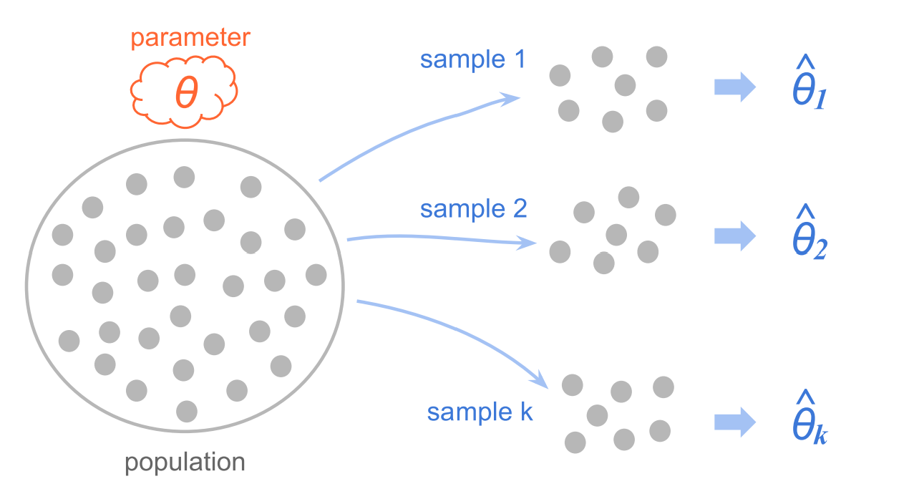
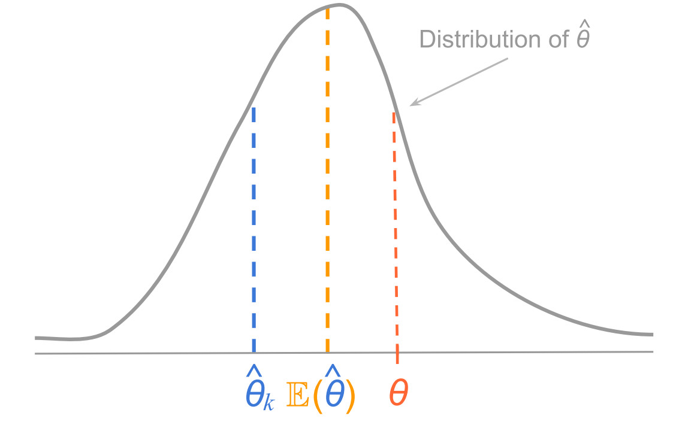
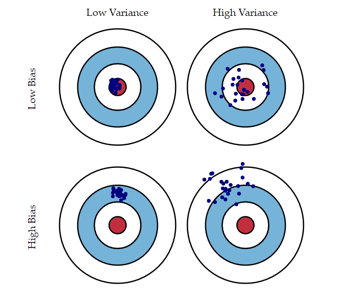
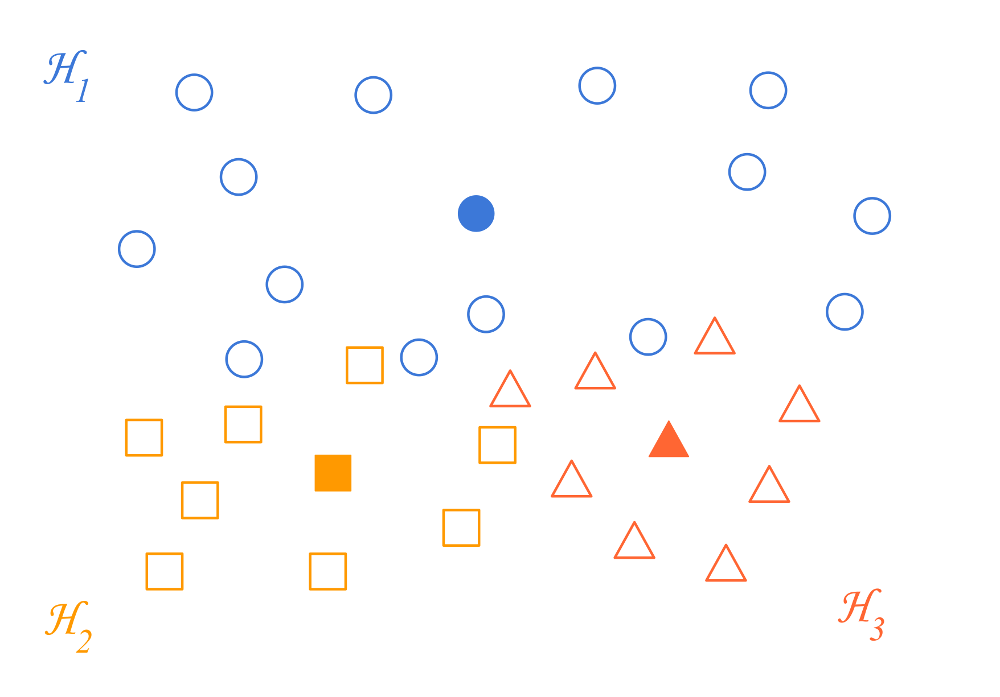
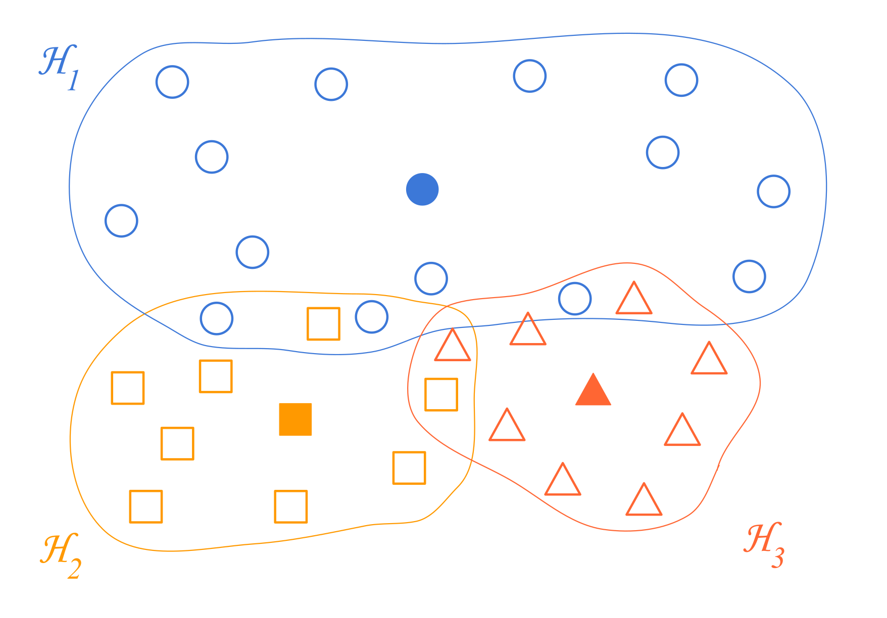
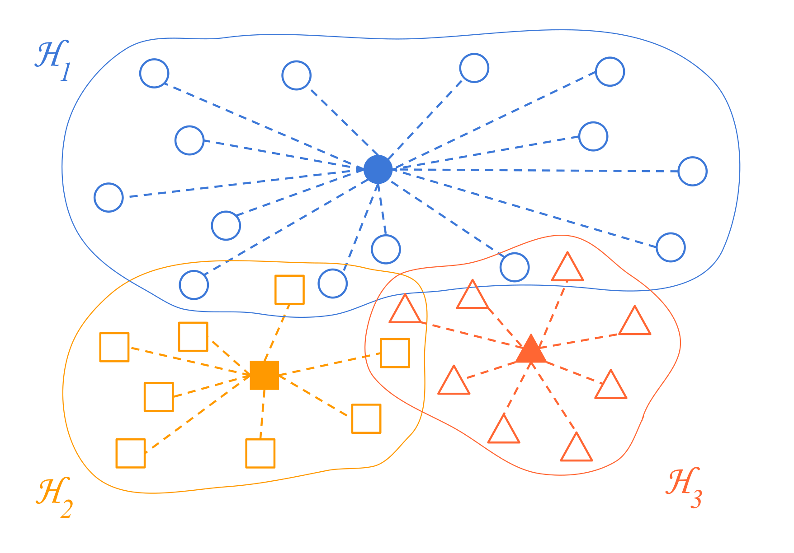
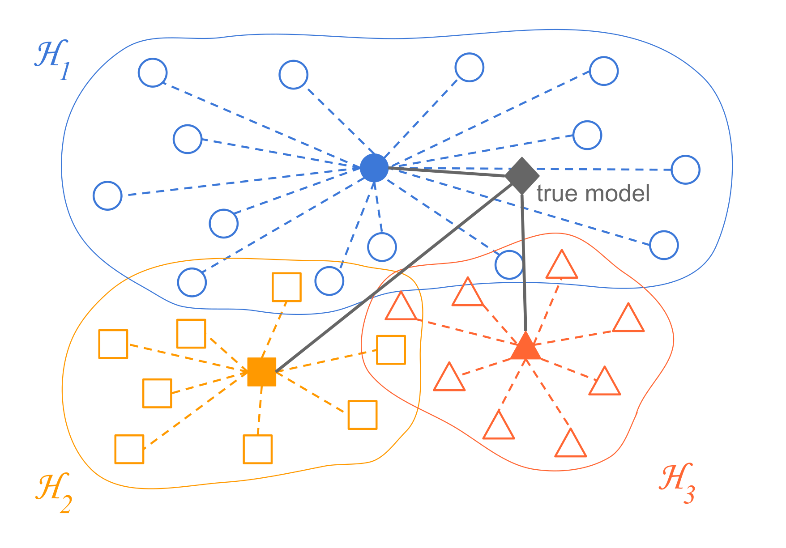
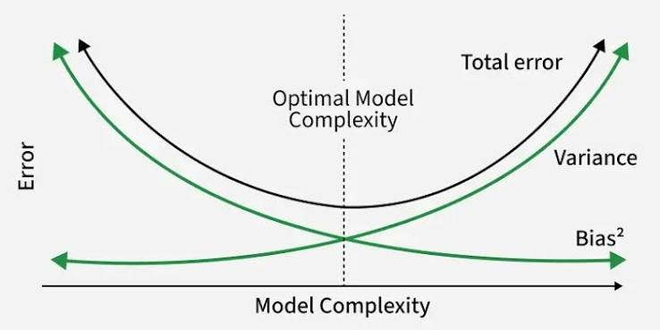

## Introduction

Once a model has been trained, we want to know how well it predicts on **new, independent data**. This is *model assessment*. A closely related problem is the choice of the hypothesis set $\mathcal{H}$ itself, for example the degree of a polynomial or the strength of a regularizer. This is *model selection* [2].

In this post, we build the tools for both questions:

1. the generalization error, the empirical risk, and why the training error is an optimistic estimate of the generalization error;
2. estimators, and the decomposition of their mean squared error into bias and variance;
3. the same decomposition for the prediction error of a learned model, and how it depends on model complexity and on the size of the training set.

### Problem setup

In supervised learning, we observe inputs together with their labels, and we want to learn a function that predicts the label of a new input. The set of all possible inputs is denoted by $\mathcal{X}$, often $\mathcal{X} \subseteq \mathbb{R}^d$, and the set of labels by $\mathcal{Y}$:

- in binary classification, $\mathcal{Y} = \{0, 1\}$;
- in regression, labels can be any real number, $\mathcal{Y} = \mathbb{R}$.

The relation between inputs and labels is described by an unknown **target function** $f: \mathcal{X} \to \mathcal{Y}$. Our objective is to learn a **predictor** $\hat{f} \approx f$ from data. To do so, we consider a family of predictors parameterized by $\theta$,

$$
\mathcal{H} = \left\{f_\theta : \theta \in \Theta\right\},
$$

where $\Theta$, called the *parameter set*, can be any set, and each $f_\theta: \mathcal{X} \to \mathcal{Y}$ is a predictor [7]. The family $\mathcal{H}$ is called the *hypothesis set*. For example, linear regression uses $f_{\boldsymbol{\theta}}(\mathbf{x}) = \boldsymbol{\theta}^\top\mathbf{x}$, with $\mathcal{X} = \mathbb{R}^d$, $\mathcal{Y} = \mathbb{R}$ and $\boldsymbol{\theta} \in \Theta = \mathbb{R}^d$.

To quantify how serious a mistake is, we use a **loss function** $\ell: \mathcal{Y} \times \mathcal{Y} \to [0, +\infty)$ such that $\ell(y, y) = 0$ for every $y \in \mathcal{Y}$. The value $\ell(f_\theta(\mathbf{x}), y)$ is the cost of predicting $f_\theta(\mathbf{x})$ when the true label is $y$. In classification, the most common choice is the **0-1 loss**

$$
\ell(f_\theta(\mathbf{x}), y) = \begin{cases}1, & \text{if } f_\theta(\mathbf{x}) \neq y\\ 0, & \text{if } f_\theta(\mathbf{x}) = y\end{cases}
$$

which can be rewritten as $\ell(f_\theta(\mathbf{x}), y) = \mathbb{I}\left(f_\theta(\mathbf{x}) \neq y\right)$, where $\mathbb{I}(\cdot)$ is the indicator function. In regression, the most common choice is the **squared loss** $\ell(f_\theta(\mathbf{x}), y) = \left(f_\theta(\mathbf{x}) - y\right)^2$, which is the loss used in the bias–variance decomposition later in this post.

**Notation.** Uppercase letters such as $X$ and $Y$ denote random variables and lowercase letters denote their values; vectors are bold ($\mathbf{x}$) and matrices are bold uppercase ($\mathbf{X}$).

## Generalization Error and Empirical Risk

We want a predictor that performs well on data we have **not** seen yet. A way to model this uncertainty is to treat a future data point and its label as a random pair $(X, Y)$ taking values in $\mathcal{X} \times \mathcal{Y}$, drawn from an unknown probability distribution $P$. The expected loss of a predictor on such a pair is

$$
R(f_\theta) = \mathbb{E}_{(X, Y) \sim P}\left[\ell(f_\theta(X), Y)\right]
$$

This quantity is called the **generalization risk** (or **generalization error**) of $f_\theta$. A good predictor is one with a small generalization error. Ideally, we would like to find $f^* \in \mathcal{H}$ such that

$$
R(f^*) = \inf_{f \in \mathcal{H}} R(f).
$$

However, $R$ cannot be computed, because $P$ is unknown. What we have instead is a sample of examples drawn from $P$, called the data, or the observations:

$$
\mathcal{S} = \left\{(X_1, Y_1), \dots, (X_n, Y_n)\right\}.
$$

<aside>

**Caution:** We assume that the pairs $(X_i, Y_i)$ are **i.i.d.** (independent and identically distributed) with distribution $P$, and independent of the future pair $(X, Y)$.

</aside>

<aside>

**Definition (Empirical risk):** For each example, $\ell(f_\theta(X_i), Y_i) \geq 0$ is the loss of $f_\theta$ on the $i$-th data point $(X_i, Y_i)$. The empirical risk of $f_\theta$ over $\mathcal{S}$ is the average loss on the sample:

$$
r(f_\theta) = \frac{1}{n}\sum_{i=1}^n \ell(f_\theta(X_i), Y_i) \tag{1}
$$

</aside>

If $f_\theta$ is **fixed**, that is, chosen without looking at $\mathcal{S}$, then $(1)$ is an unbiased estimator of the generalization error:

$$
\mathbb{E}_{\mathcal{S} \sim P^n}\left[r(f_\theta)\right] = R(f_\theta)
$$

*Proof:* Since $f_\theta$ does not depend on $\mathcal{S}$, the $i$-th term of the sum only involves the pair $(X_i, Y_i)$, whose distribution is $P$. Therefore

$$
\begin{align*}
\mathbb{E}_{\mathcal{S}}\left[r(f_\theta)\right]
&= \mathbb{E}_{\mathcal{S}}\left[\frac{1}{n}\sum_{i=1}^n \ell(f_\theta(X_i), Y_i)\right] \\
&= \frac{1}{n}\sum_{i=1}^n \mathbb{E}_{\mathcal{S}}\left[\ell(f_\theta(X_i), Y_i)\right] && \text{(linearity of expectation)} \\
&= \frac{1}{n}\sum_{i=1}^n \mathbb{E}_{(X_i, Y_i) \sim P}\left[\ell(f_\theta(X_i), Y_i)\right] && \text{(each term only involves } (X_i, Y_i)\text{)} \\
&= \frac{1}{n}\sum_{i=1}^n R(f_\theta) = R(f_\theta)
\end{align*}
$$

The word *fixed* is essential. For a predictor learned from $\mathcal{S}$ itself, such as the empirical risk minimizer below, this equality no longer holds; see [Test data vs Training data](#test-data-vs-training-data).

### Empirical Risk Minimizer (ERM)

Each parameter $\theta \in \Theta$ defines a predictor $f_\theta \in \mathcal{H}$, so we can write both risks as functions of the parameter [7]:

$$
R(\theta) := R(f_\theta), \qquad r(\theta) := r(f_\theta).
$$

We write $\mathbb{P}_\mathcal{S}$ and $\mathbb{E}_\mathcal{S}$ for probabilities and expectations with respect to the sample $\mathcal{S}$.

An **estimator** $\hat{\theta}((X_1, Y_1), \dots, (X_n, Y_n))$ is a function of the sample that returns the parameter we should use for future predictions. Formally,

$$
\hat{\theta}: \bigcup_{n=1}^{\infty}(\mathcal{X} \times \mathcal{Y})^n \to \Theta
$$

For short, we write $\hat{\theta}$ instead of $\hat{\theta}((X_1, Y_1), \dots, (X_n, Y_n))$. Because it depends on the random sample, $\hat{\theta}$ is itself a random variable.

<aside>

**Definition (Empirical Risk Minimizer, or ERM):**

$$
\hat{\theta}_{\text{ERM}} \in \arg\min_{\theta \in \Theta} r(\theta)
$$

The symbol $\in$ reminds us that the minimizer may not be unique; any minimizer can be used.

</aside>

Our objective is to minimize $R$, but we are not able to evaluate it, because the probability distribution $P$ is unknown. ERM minimizes $r$ instead, hoping that a parameter with a small empirical risk also has a small generalization risk. The first justification of this idea is the law of large numbers.

    
Law of Large Numbers

<aside>

Theorem 1 (Weak Law of Large Numbers) [6]: Let $X_1, X_2, \dots$ be iid random variables with $\mathbb{E}[X_i] = \mu$ and $\operatorname{Var}(X_i) = \sigma^2 < \infty$, and define $\bar{X}_n = \frac{1}{n}\sum_{i=1}^nX_i$. Then, for every $\epsilon > 0$,

$$
\underset{n\to \infty}{\lim}\mathbb{P}\left(\vert{}\bar{X}_n-\mu\vert{}< \epsilon \right) = 1
$$

that is, $\bar{X}_n$ converges in probability to $\mu$.

</aside>

*Proof:* Since the $X_i$ are independent, $\operatorname{Var}\left(\bar{X}_n\right) = \frac{1}{n^2}\sum_{i=1}^n \operatorname{Var}(X_i) = \frac{\sigma^2}{n}$. For every $\epsilon > 0$, Chebyshev's inequality gives

$$
\mathbb{P}\left(\vert{}\bar{X}_n-\mu\vert{} \geq \epsilon \right) = \mathbb{P}\left((\bar{X}_n-\mu)^2 \geq \epsilon^2 \right) \leq \frac{\mathbb{E}\left[(\bar{X}_n - \mu)^2\right]}{\epsilon^2} = \frac{\operatorname{Var}\left(\bar{X}_n\right)}{\epsilon^2} = \frac{\sigma^2}{n\epsilon^2}
$$

Hence,

$$
\mathbb{P}\left(\vert{}\bar{X}_n-\mu\vert{} < \epsilon \right) = 1- \mathbb{P}\left(\vert{}\bar{X}_n-\mu\vert{} \geq \epsilon \right) \geq 1 - \frac{\sigma^2}{n\epsilon^2}
$$

As $n \to \infty$, the right-hand side tends to $1$, and a probability can never exceed $1$. By the squeeze theorem,

$$
\underset{n\to \infty}{\lim}\mathbb{P}\left(\vert{}\bar{X}_n-\mu\vert{}< \epsilon \right) = 1
$$

The Weak Law of Large Numbers states that, under general conditions, the sample mean approaches the population mean as $n \to \infty$.

<aside>

Theorem 2 (Strong Law of Large Numbers) [6]: Let $X_1, X_2, \dots$ be iid random variables with $\mathbb{E}[X_i] = \mu$ and $\operatorname{Var}(X_i) = \sigma^2 < \infty$, and define $\bar{X}_n = \frac{1}{n}\sum_{i=1}^nX_i$. Then, for every $\epsilon > 0$,

$$
\mathbb{P}\left(\underset{n\to \infty}{\lim}\vert{\bar{X}_n-\mu}\vert{} < \epsilon\right) = 1
$$

that is, $\bar{X}_n$ converges almost surely to $\mu$.

</aside>

This form follows the definition of almost sure convergence in [6]: a sequence $X_1, X_2, \dots$ converges almost surely to $X$ if $\mathbb{P}\left(\lim_{n\to\infty} \vert X_n - X\vert < \epsilon\right) = 1$ for every $\epsilon > 0$. Almost sure convergence implies convergence in probability, so the strong law is the stronger statement.

To apply the law of large numbers to the empirical risk, fix $\theta$ and let $Z_i = \ell(f_\theta(X_i), Y_i)$. The $Z_i$ are i.i.d., because they are functions of the i.i.d. pairs $(X_i, Y_i)$, and their mean is $\mathbb{E}[Z_i] = R(\theta)$. If their variance is finite (for example, when the loss is bounded, as for the 0-1 loss), the Strong Law of Large Numbers applied to $\bar{Z}_n = r(\theta)$ gives

$$
r(\theta) = \frac{1}{n}\sum_{i=1}^n \ell(f_\theta(X_i), Y_i) \xrightarrow[n\to\infty]{\text{a.s.}} \mathbb{E}_{(X, Y) \sim P}\left[\ell(f_\theta(X), Y)\right] = R(\theta)
$$

that is, for every fixed $\theta$, the empirical risk is a consistent estimator of the generalization error.

<aside>

**Pointwise convergence is not enough.** The law of large numbers holds for each **fixed** $\theta$, but $\hat{\theta}_{\text{ERM}}$ is chosen *after* looking at the data, among all $\theta \in \Theta$ at once. Let $\theta^* \in \arg\min_{\theta \in \Theta} R(\theta)$ be the best parameter (assuming it exists). Since $r(\hat{\theta}_{\text{ERM}}) \le r(\theta^*)$,

$$
\begin{align*}
R(\hat{\theta}_{\text{ERM}}) &\le r(\hat{\theta}_{\text{ERM}}) + \sup_{\theta \in \Theta}\left|r(\theta) - R(\theta)\right| \\
&\le r(\theta^*) + \sup_{\theta \in \Theta}\left|r(\theta) - R(\theta)\right| \\
&\le R(\theta^*) + 2\sup_{\theta \in \Theta}\left|r(\theta) - R(\theta)\right|
\end{align*}
$$

So ERM is guaranteed to be close to the best parameter when the convergence holds **uniformly** over $\Theta$, that is, when $\sup_{\theta \in \Theta}\left|r(\theta) - R(\theta)\right| \to 0$. If $\Theta$ is too rich, this fails: a flexible enough model can drive $r$ to zero on any sample while $R$ stays large. Controlling this uniform deviation is the goal of PAC bounds [7], and it is the theoretical root of the overfitting discussed later in this post.

</aside>

### Test data vs Training data

Why not simply use the training error $r(\hat{\theta}_{\text{ERM}})$ to estimate the generalization error, instead of keeping separate test data? Because the training error of the ERM is **optimistic**: on average, it underestimates the generalization error. This is called the *optimism* of the training error [2].

To show this, we prove the inequality

$$
\mathbb{E}_\mathcal{S}\left[r\left(\hat{\theta}_{\text{ERM}}\right)\right] \leq \mathbb{E}_\mathcal{S}\left[R\left(\hat{\theta}_{\text{ERM}}\right)\right]
$$

*Proof:* Recall from [Empirical Risk Minimizer (ERM)](#empirical-risk-minimizer-erm) that

$$
\hat{\theta}_{\text{ERM}} \in \arg\min_{\theta \in \Theta} r(\theta) \qquad \theta^* \in \arg\min_{\theta \in \Theta} R(\theta)
$$

The parameter $\theta^*$ is the best one for the whole population, so it does not depend on the dataset $\mathcal{S}$. We use three facts:

- since $\hat{\theta}_{\text{ERM}}$ minimizes $r$, we have $r(\hat{\theta}_{\text{ERM}}) \le r(\theta^*)$ for every sample, hence $\mathbb{E}_{\mathcal{S}}\big[r(\hat{\theta}_{\text{ERM}})\big] \le \mathbb{E}_{\mathcal{S}}\big[r(\theta^*)\big]$;
- since $\theta^*$ is fixed, the empirical risk is unbiased for it: $\mathbb{E}_{\mathcal{S}}\big[r(\theta^*)\big] = R(\theta^*)$;
- since $\theta^*$ minimizes $R$, we have $R(\theta^*) \le R(\hat{\theta}_{\text{ERM}})$ for every sample, hence $R(\theta^*) \le \mathbb{E}_{\mathcal{S}}\big[R(\hat{\theta}_{\text{ERM}})\big]$.

Chaining the three facts,

$$
\mathbb{E}_{\mathcal{S}}\big[r(\hat{\theta}_{\text{ERM}})\big] \le \mathbb{E}_{\mathcal{S}}\big[r(\theta^*)\big] = R(\theta^*) = \min_{\theta \in \Theta} R(\theta) \le \mathbb{E}_{\mathcal{S}}\big[R(\hat{\theta}_{\text{ERM}})\big]
$$

Equivalently, the **generalization gap** of the ERM is non-negative on average:

$$
\mathbb{E}_\mathcal{S}\Big[\underbrace{R\left(\hat{\theta}_{\text{ERM}}\right) - r\left(\hat{\theta}_{\text{ERM}}\right)}_{\text{Generalization Gap}}\Big] \geq 0
$$

In words, on average, the training error of the ERM never exceeds its generalization error. The reason is that $\hat{\theta}_{\text{ERM}}$ was chosen to fit $\mathcal{S}$ well, so $\mathcal{S}$ is no longer an independent sample for the predictor $f_{\hat{\theta}_{\text{ERM}}}$, and the unbiasedness argument of the previous section does not apply. For linear regression, the size of this gap is computed exactly in $(7)$ below: it equals $2\sigma^2 p/n$.

Now let $\mathcal{S}' = \{(X'_1, Y'_1), \dots, (X'_m, Y'_m)\}$ be a **test set** of $m$ new i.i.d. examples from $P$, independent of $\mathcal{S}$, and define the test error

$$
r_{\mathcal{S}'}(\theta) = \frac{1}{m}\sum_{j=1}^{m} \ell(f_\theta(X'_j), Y'_j)
$$

Once the training set $\mathcal{S}$ is given, $\hat{\theta}_{\text{ERM}}$ is a fixed parameter that does not depend on $\mathcal{S}'$, so the unbiasedness argument applies again:

$$
\begin{align*}
\mathbb{E}_{\mathcal{S}'}\left[r_{\mathcal{S}'}(\hat{\theta}_{\text{ERM}}) \,\middle|\, \mathcal{S}\right]
&= \frac{1}{m}\sum_{j=1}^{m}\mathbb{E}_{(X'_j, Y'_j) \sim P}\left[\ell\left(f_{\hat{\theta}_{\text{ERM}}}(X'_j), Y'_j\right)\right] \\
&= \frac{1}{m}\sum_{j=1}^{m} R(\hat{\theta}_{\text{ERM}}) = R(\hat{\theta}_{\text{ERM}})
\end{align*}
$$

As a result, the test error is an unbiased estimator of the generalization error of the model we actually trained, which the training error is not.

How accurate is this estimate? For a loss with values in $[0, 1]$, such as the 0-1 loss, the terms of $r_{\mathcal{S}'}$ are i.i.d. and bounded, so Hoeffding's inequality gives, for every $\epsilon > 0$,

$$
\mathbb{P}\left(\left|r_{\mathcal{S}'}(\hat{\theta}_{\text{ERM}}) - R(\hat{\theta}_{\text{ERM}})\right| \geq \epsilon \,\middle|\, \mathcal{S}\right) \leq 2\exp\left(-2m\epsilon^2\right)
$$

For example, with $m = 1000$ test examples, the test error is within $0.05$ of the generalization error with probability at least $1 - 2e^{-5} \approx 0.987$. This guarantee requires that the test set is used **once**, after training. If it is used to choose among many models, it becomes part of the learning process and its estimate becomes optimistic again, which is why model selection relies on a separate validation set.

## Estimation and Distribution of Estimators

**Estimation** consists of approximating an unknown parameter of a population, using a random sample of observations drawn from that population.

For example, consider all students of a university, and let $\theta$ be their average height. We call this theoretical average the *parameter*. Measuring every student is impractical, so we draw a random sample of $n$ students and use their average height as an approximation of $\theta$.

Formally, an **estimator** is a function of the sample, $\hat{\theta} = g(X_1, \dots, X_n)$. Since the sample is random, an estimator is a **random variable**:

- the first sample of size $n$ results in a value $\hat{\theta}_1$;
- the second sample of size $n$ results in a different value $\hat{\theta}_2$;
- and so on.

Some samples yield a $\hat{\theta}_k$ that overestimates $\theta$, others one that underestimates it, and some are very close to it. If we could draw a very large number of samples, the histogram of $\hat{\theta}_1, \hat{\theta}_2, \dots$ would show the **sampling distribution** of $\hat{\theta}$:

Two features of this distribution matter: where it is centered, compared with $\theta$, and how widely it is spread. They are exactly the **bias** and the **variance** of the estimator. The parameter $\hat{\theta}_{\text{ERM}}$ of the previous section is an estimator in exactly this sense.

### Bias-Variance Decomposition

How far is $\hat{\theta}$ from $\theta$ on average? The error $\hat{\theta} - \theta$ is itself random and can be positive or negative, so we measure its average squared size, the **Mean Squared Error** (MSE). Write $\mu_{\hat{\theta}} = \mathbb{E}[\hat{\theta}]$ for the mean of the sampling distribution, and define the bias and the variance of $\hat{\theta}$ as

$$
\operatorname{Bias}(\hat{\theta}) = \mu_{\hat{\theta}} - \theta, \qquad \operatorname{Var}(\hat{\theta}) = \mathbb{E}\left[(\hat{\theta} - \mu_{\hat{\theta}})^2\right]
$$

Adding and subtracting $\mu_{\hat{\theta}}$,

$$
\begin{align*}
\text{MSE}(\hat{\theta}) &= \mathbb{E}\left[(\hat{\theta} - \theta)^2\right] \\
&= \mathbb{E}\left[\left((\hat{\theta} - \mu_{\hat{\theta}}) + (\mu_{\hat{\theta}} - \theta)\right)^2\right] \\
&= \mathbb{E}\left[(\hat{\theta} - \mu_{\hat{\theta}})^2\right] + 2\,\mathbb{E}\left[(\hat{\theta} - \mu_{\hat{\theta}})(\mu_{\hat{\theta}} - \theta)\right] + \mathbb{E}\left[(\mu_{\hat{\theta}} - \theta)^2\right] \\
&= \mathbb{E}\left[(\hat{\theta} - \mu_{\hat{\theta}})^2\right] + 2(\mu_{\hat{\theta}} - \theta)\,\mathbb{E}\left[\hat{\theta} - \mu_{\hat{\theta}}\right] + (\mu_{\hat{\theta}} - \theta)^2 \\
&= \mathbb{E}\left[(\hat{\theta} - \mu_{\hat{\theta}})^2\right] + 2(\mu_{\hat{\theta}} - \theta) \cdot 0 + (\mu_{\hat{\theta}} - \theta)^2
\end{align*}
$$

because $\mu_{\hat{\theta}} - \theta$ is a constant and $\mathbb{E}\left[\hat{\theta} - \mu_{\hat{\theta}}\right] = \mu_{\hat{\theta}} - \mu_{\hat{\theta}} = 0$. Hence,

$$
\mathbb{E}\left[(\hat{\theta} - \theta)^2\right] = \underbrace{\mathbb{E}\left[(\hat{\theta} - \mu_{\hat{\theta}})^2\right]}_{\text{Variance}} + \underbrace{(\mu_{\hat{\theta}} - \theta)^2}_{\text{Bias}^2} = \operatorname{Var}(\hat{\theta}) + \operatorname{Bias}^2(\hat{\theta}) \tag{2}
$$

**Example (an unbiased estimator is not always the best one)** [6]. Let $X_1, \dots, X_n$ be i.i.d. $\mathcal{N}(\mu, \sigma^2)$ with $n \ge 2$, and compare two estimators of $\sigma^2$: the sample variance and the maximum likelihood estimator,

$$
S^2 = \frac{1}{n-1}\sum_{i=1}^n (X_i - \bar{X}_n)^2, \qquad \hat{\sigma}^2 = \frac{1}{n}\sum_{i=1}^n (X_i - \bar{X}_n)^2 = \frac{n-1}{n}S^2
$$

For normal samples, $\mathbb{E}[S^2] = \sigma^2$ and $\operatorname{Var}(S^2) = \frac{2\sigma^4}{n-1}$. Using $(2)$,

$$
\begin{align*}
\text{MSE}(S^2) &= \operatorname{Var}(S^2) + 0^2 = \frac{2\sigma^4}{n-1} \\
\text{MSE}(\hat{\sigma}^2) &= \left(\frac{n-1}{n}\right)^2\frac{2\sigma^4}{n-1} + \left(\frac{n-1}{n}\sigma^2 - \sigma^2\right)^2 = \frac{2(n-1)\sigma^4}{n^2} + \frac{\sigma^4}{n^2} = \frac{(2n-1)\sigma^4}{n^2}
\end{align*}
$$

Since $(2n-1)(n-1) = 2n^2 - 3n + 1 < 2n^2$, we get $\text{MSE}(\hat{\sigma}^2) < \text{MSE}(S^2)$ for every $n \ge 2$: the biased estimator is more accurate, because the small bias it accepts buys a larger reduction in variance. The same tradeoff appears below for predictors.

### Bias-Variance Decomposition with noisy targets

We now apply the same idea to predictors, using the squared loss. Let $h^{(\mathcal{S})} = f_{\hat{\theta}}$ be the predictor learned from a training set $\mathcal{S}$ of $n$ points, and fix a new input $\mathbf{x}_0$. As $\mathcal{S}$ varies, the prediction $h^{(\mathcal{S})}(\mathbf{x}_0)$ is a random variable, exactly like the estimator $\hat{\theta}$ above, and the true value $f(\mathbf{x}_0)$ plays the role of the parameter $\theta$.

Without noise, the expected squared error at $\mathbf{x}_0$ over all possible training sets is

$$
\mathbb{E}_\mathcal{S}\left[\left(h^{(\mathcal{S})}(\mathbf{x}_0) - f(\mathbf{x}_0)\right)^2\right]
$$

where

- $h^{(\mathcal{S})}$ is obtained by fitting a model on a specific training set $\mathcal{S}$;
- $h^{(\mathcal{S})}(\mathbf{x}_0)$ is its prediction for the out-of-sample input $\mathbf{x}_0$.

The **average hypothesis** plays the role of $\mu_{\hat{\theta}} = \mathbb{E}[\hat{\theta}]$:

$$
\bar{h}(\mathbf{x}_0) = \mathbb{E}_\mathcal{S}\left[h^{(\mathcal{S})}(\mathbf{x}_0)\right]
$$

and the same computation as in $(2)$ gives the bias-variance decomposition

$$
\mathbb{E}_\mathcal{S}\left[\left(h^{(\mathcal{S})}(\mathbf{x}_0) - f(\mathbf{x}_0)\right)^2\right] 
= \underbrace{\mathbb{E}_\mathcal{S}\left[\left(h^{(\mathcal{S})}(\mathbf{x}_0) - \bar{h}(\mathbf{x}_0)\right)^2\right]}_{\texttt{variance}} + \underbrace{\left(\bar{h}(\mathbf{x}_0) - f(\mathbf{x}_0)\right)^2}_{\texttt{bias}^2} \tag{3}
$$

In practice, there will be some noise. Instead of $y = f(\mathbf{x})$, the observed target is

$$
y = f(\mathbf{x}) + \epsilon, \qquad \mathbb{E}[\epsilon] = 0, \quad \operatorname{Var}(\epsilon) = \sigma^2.
$$

With noise, two individuals may have identical inputs, $\mathbf{x}_A = \mathbf{x}_B$, but different responses, $y_A \neq y_B$.

We now measure the error of $h^{(\mathcal{S})}$ against the noisy target $y_0 = f(\mathbf{x}_0) + \epsilon$ at the fixed test input $\mathbf{x}_0$. The noise $\epsilon$ of the test point is independent of the training set $\mathcal{S}$, and therefore independent of $h^{(\mathcal{S})}(\mathbf{x}_0)$.

**Step 1: separate the noise.** Since $h^{(\mathcal{S})}(\mathbf{x}_0) - y_0 = \left(h^{(\mathcal{S})}(\mathbf{x}_0) - f(\mathbf{x}_0)\right) - \epsilon$,

$$
\begin{align*}
\mathbb{E}_{\mathcal{S},\epsilon}\left[\left(h^{(\mathcal{S})}(\mathbf{x}_0) - y_0\right)^2\right]
&= \mathbb{E}_{\mathcal{S},\epsilon}\left[\left(\left(h^{(\mathcal{S})}(\mathbf{x}_0) - f(\mathbf{x}_0)\right) - \epsilon\right)^2\right] \\
&= \mathbb{E}_{\mathcal{S},\epsilon}\left[\left(h^{(\mathcal{S})}(\mathbf{x}_0) - f(\mathbf{x}_0)\right)^2\right] - 2\,\mathbb{E}_{\mathcal{S},\epsilon}\left[\left(h^{(\mathcal{S})}(\mathbf{x}_0) - f(\mathbf{x}_0)\right)\epsilon\right] + \mathbb{E}_{\epsilon}\left[\epsilon^2\right] \\
&= \mathbb{E}_{\mathcal{S}}\left[\left(h^{(\mathcal{S})}(\mathbf{x}_0) - f(\mathbf{x}_0)\right)^2\right] - 2\,\mathbb{E}_{\mathcal{S}}\left[h^{(\mathcal{S})}(\mathbf{x}_0) - f(\mathbf{x}_0)\right]\mathbb{E}_{\epsilon}[\epsilon] + \left(\operatorname{Var}(\epsilon) + \left(\mathbb{E}_{\epsilon}[\epsilon]\right)^2\right) \\
&= \mathbb{E}_{\mathcal{S}}\left[\left(h^{(\mathcal{S})}(\mathbf{x}_0) - f(\mathbf{x}_0)\right)^2\right] - 2\,\mathbb{E}_{\mathcal{S}}\left[h^{(\mathcal{S})}(\mathbf{x}_0) - f(\mathbf{x}_0)\right] \cdot 0 + \left(\sigma^2 + 0^2\right) \\
&= \mathbb{E}_{\mathcal{S}}\left[\left(h^{(\mathcal{S})}(\mathbf{x}_0) - f(\mathbf{x}_0)\right)^2\right] + \sigma^2
\end{align*}
$$

where:

- the first term does not involve $\epsilon$, so $\mathbb{E}_{\mathcal{S},\epsilon}$ reduces to $\mathbb{E}_{\mathcal{S}}$;
- the cross term factorizes because $\epsilon$ is independent of $\mathcal{S}$, and it vanishes because $\mathbb{E}_{\epsilon}[\epsilon] = 0$;
- the last term is $\mathbb{E}_{\epsilon}\left[\epsilon^2\right] = \operatorname{Var}(\epsilon) + \left(\mathbb{E}_{\epsilon}[\epsilon]\right)^2 = \sigma^2$.

**Step 2: decompose the remaining term**, which proves $(3)$. Adding and subtracting the average hypothesis $\bar{h}(\mathbf{x}_0)$,

$$
\begin{align*}
\mathbb{E}_{\mathcal{S}}\left[\left(h^{(\mathcal{S})}(\mathbf{x}_0) - f(\mathbf{x}_0)\right)^2\right]
&= \mathbb{E}_{\mathcal{S}}\left[\left(\left(h^{(\mathcal{S})}(\mathbf{x}_0) - \bar{h}(\mathbf{x}_0)\right) + \left(\bar{h}(\mathbf{x}_0) - f(\mathbf{x}_0)\right)\right)^2\right] \\
&= \mathbb{E}_{\mathcal{S}}\left[\left(h^{(\mathcal{S})}(\mathbf{x}_0) - \bar{h}(\mathbf{x}_0)\right)^2\right] + 2\,\mathbb{E}_{\mathcal{S}}\left[\left(h^{(\mathcal{S})}(\mathbf{x}_0) - \bar{h}(\mathbf{x}_0)\right)\left(\bar{h}(\mathbf{x}_0) - f(\mathbf{x}_0)\right)\right] + \mathbb{E}_{\mathcal{S}}\left[\left(\bar{h}(\mathbf{x}_0) - f(\mathbf{x}_0)\right)^2\right] \\
&= \mathbb{E}_{\mathcal{S}}\left[\left(h^{(\mathcal{S})}(\mathbf{x}_0) - \bar{h}(\mathbf{x}_0)\right)^2\right] + 2\left(\bar{h}(\mathbf{x}_0) - f(\mathbf{x}_0)\right)\left(\mathbb{E}_{\mathcal{S}}\left[h^{(\mathcal{S})}(\mathbf{x}_0)\right] - \bar{h}(\mathbf{x}_0)\right) + \left(\bar{h}(\mathbf{x}_0) - f(\mathbf{x}_0)\right)^2 \\
&= \mathbb{E}_{\mathcal{S}}\left[\left(h^{(\mathcal{S})}(\mathbf{x}_0) - \bar{h}(\mathbf{x}_0)\right)^2\right] + 2\left(\bar{h}(\mathbf{x}_0) - f(\mathbf{x}_0)\right) \cdot 0 + \left(\bar{h}(\mathbf{x}_0) - f(\mathbf{x}_0)\right)^2 \\
&= \underbrace{\mathbb{E}_{\mathcal{S}}\left[\left(h^{(\mathcal{S})}(\mathbf{x}_0) - \bar{h}(\mathbf{x}_0)\right)^2\right]}_{\texttt{variance}} + \underbrace{\left(\bar{h}(\mathbf{x}_0) - f(\mathbf{x}_0)\right)^2}_{\texttt{bias}^2}
\end{align*}
$$

Here $\bar{h}(\mathbf{x}_0) - f(\mathbf{x}_0)$ does not depend on $\mathcal{S}$, so it can be taken out of $\mathbb{E}_{\mathcal{S}}$, and $\mathbb{E}_{\mathcal{S}}\left[h^{(\mathcal{S})}(\mathbf{x}_0)\right] - \bar{h}(\mathbf{x}_0) = 0$ by the definition of $\bar{h}$.

**Putting the two steps together:**

$$
\mathbb{E}_{\mathcal{S},\epsilon}\left[\left(h^{(\mathcal{S})}(\mathbf{x}_0) - y_0\right)^2\right] = \underbrace{\mathbb{E}_{\mathcal{S}}\left[\left(h^{(\mathcal{S})}(\mathbf{x}_0) - \bar{h}(\mathbf{x}_0)\right)^2\right]}_{\texttt{variance}} + \underbrace{\left(\bar{h}(\mathbf{x}_0) - f(\mathbf{x}_0)\right)^2}_{\texttt{bias}^2} + \underbrace{\sigma^2}_{\text{noise}} \tag{4}
$$

The noise term $\sigma^2$ is the *irreducible error*: no hypothesis can predict $\epsilon$, so the expected squared error at $\mathbf{x}_0$ is never smaller than $\sigma^2$, however good $h^{(\mathcal{S})}$ is.

## Bias, Variance, and Model Complexity

### What is model complexity?

Before discussing the tradeoff, we need a precise idea of what "complexity" means. Informally, the **complexity** (or **capacity**) of a model is the richness of its hypothesis space $\mathcal{H}$: how many different functions the learning algorithm can choose from, and therefore how many patterns, real or accidental, it is able to fit.

A simple example is polynomial regression with one input $x$:

$$
f_{\mathbf{w}}(x) = w_0 + w_1 x + w_2 x^2 + \dots + w_d x^d, \qquad \mathbf{w} = (w_0, w_1, \dots, w_d)^\top \in \mathbb{R}^{d+1}.
$$

Let $\mathcal{H}_d$ be the set of all polynomials of degree at most $d$. A polynomial of degree $d$ is also a polynomial of degree $d+1$ (take $w_{d+1} = 0$), so the hypothesis spaces are **nested**:

$$
\mathcal{H}_0 \subset \mathcal{H}_1 \subset \mathcal{H}_2 \subset \cdots
$$

Increasing $d$ enlarges the set of curves the model can draw: a line ($d = 1$) can only capture a trend, a cubic ($d = 3$) can bend twice, and a polynomial of degree $9$ can pass exactly through $10$ training points, noise included [1].

There are several ways to measure complexity:

- **Number of free parameters**: $d + 1$ for a polynomial of degree $d$, $p$ for a linear model $f_{\mathbf{w}}(\mathbf{x}) = \mathbf{w}^\top\mathbf{x}$ with $\mathbf{x} \in \mathbb{R}^p$. It is simple, but it ignores constraints such as regularization.
- **Effective degrees of freedom** (defined below), which measures how strongly the fitted values follow the training targets.
- **VC dimension**: the size of the largest set of points that $\mathcal{H}$ can label in every possible way. It is the complexity measure behind the PAC generalization bounds discussed in the [PAC learning post](../2026-11-11-pac-learning-framework-vs-pac-bayes/en.md).

For a method that produces fitted values $\hat{\mathbf{y}} = (\hat{y}_1, \dots, \hat{y}_n)^\top$ on the training set, the effective degrees of freedom are [2] (Section 7.6)

$$
\operatorname{df}(\hat{\mathbf{y}}) = \frac{1}{\sigma^2}\sum_{i=1}^{n}\operatorname{Cov}(\hat{y}_i, y_i).
$$

For a *linear smoother* $\hat{\mathbf{y}} = \mathbf{L}\mathbf{y}$ this reduces to $\operatorname{df} = \operatorname{tr}(\mathbf{L})$. Least squares with $p$ features gives $\operatorname{df} = p$; ridge regression with penalty $\lambda$ gives $\operatorname{df}(\lambda) = \sum_{j=1}^{p} \frac{d_j^2}{d_j^2 + \lambda}$, where $d_j$ are the singular values of the design matrix $\mathbf{X}$; $k$-nearest neighbors gives $\operatorname{df} = n/k$.

In practice, every model family has a "knob" that controls its complexity:

| Model | Complexity knob | More complex when |
| --- | --- | --- |
| Polynomial regression | degree $d$ | $d$ increases |
| Ridge / Lasso | penalty $\lambda$ | $\lambda$ decreases |
| $k$-nearest neighbors | number of neighbors $k$ | $k$ decreases |
| Decision tree | maximum depth | the tree grows deeper |
| Neural network | width, depth, training epochs | more units, layers or epochs |

One property follows directly from nestedness: **the training error can only decrease as complexity increases.** If $\mathcal{H}_d \subset \mathcal{H}_{d+1}$, every candidate in $\mathcal{H}_d$ is also available in $\mathcal{H}_{d+1}$, hence

$$
\min_{f \in \mathcal{H}_{d+1}} r(f) \le \min_{f \in \mathcal{H}_{d}} r(f).
$$

This is why the training error cannot be used to choose the complexity: it always prefers the most complex model. What matters is the error on **new** data, and the decomposition $(4)$ tells us how it behaves.

**The bullseye.** Fix a test input $\mathbf{x}_0$. In the figure below, the center of the target is the true value $f(\mathbf{x}_0)$, and each dot is a prediction $h^{(\mathcal{S})}(\mathbf{x}_0)$ of a model trained on a different training set $\mathcal{S}$ [4]. The center of the cloud of dots is the average prediction $\bar{h}(\mathbf{x}_0)$, so

- the distance from the center of the cloud to the bullseye is the **bias**, $\bar{h}(\mathbf{x}_0) - f(\mathbf{x}_0)$;
- how widely the dots scatter around their own center is the **variance**, $\mathbb{E}_{\mathcal{S}}\left[\left(h^{(\mathcal{S})}(\mathbf{x}_0) - \bar{h}(\mathbf{x}_0)\right)^2\right]$.

The four panels are the four combinations:

- **Low bias, low variance**: every training set gives a prediction close to the truth. This is what we want.
- **Low bias, high variance**: the predictions are right *on average*, but any single trained model can be far off. This is the signature of overfitting.
- **High bias, low variance**: the predictions agree with each other but are consistently wrong. This is the signature of underfitting.
- **High bias, high variance**: wrong on average and unstable.

**The hypothesis spaces.** The next four figures show the same idea in the space of hypotheses instead of the space of predictions.

Three learning algorithms work with the hypothesis spaces $\mathcal{H}_1$ (circles), $\mathcal{H}_2$ (squares) and $\mathcal{H}_3$ (triangles). Each hollow marker is the hypothesis $h^{(\mathcal{S})}$ learned from one training set $\mathcal{S}$, and the filled marker is the average hypothesis $\bar{h}$.

The contours delimit the region of functions each space can represent. $\mathcal{H}_1$ covers the largest region, so it is the most complex of the three.

The dashed lines connect each learned hypothesis to the average hypothesis of its space. The **variance** is the average squared length of these lines. The hypotheses of $\mathcal{H}_1$ are spread over the widest area: a flexible space lets the learned function change a lot from one training set to another.

Finally, the true model is added, and the solid line from each average hypothesis to it is the **bias**. The true model lies inside $\mathcal{H}_1$ but outside $\mathcal{H}_2$ and $\mathcal{H}_3$. The average hypothesis of the rich space $\mathcal{H}_1$ therefore lands close to it, while $\mathcal{H}_2$ stays far away: no hypothesis in $\mathcal{H}_2$ can reach the true model, however much data we collect.

The pictures summarize the two sources of error:

- **bias** measures how far the hypothesis space, on average, is from the truth. It is a property of $\mathcal{H}$ and of the learning algorithm;
- **variance** measures how much the learned hypothesis moves when the training set changes. It grows with the size of $\mathcal{H}$ and shrinks as the training set grows.

### The bias–variance tradeoff

Recall the decomposition $(4)$ of the expected test error at $\mathbf{x}_0$:

$$
\operatorname{Err}(\mathbf{x}_0) = \mathbb{E}_{\mathcal{S},\epsilon}\left[\left(h^{(\mathcal{S})}(\mathbf{x}_0) - y_0\right)^2\right] = \sigma^2 + \texttt{bias}^2 + \texttt{variance}.
$$

When the complexity of the model increases:

- **$\texttt{bias}^2$ decreases**: a larger hypothesis space contains functions closer to $f$, so the average hypothesis $\bar{h}$ moves toward $f$;
- **$\texttt{variance}$ increases**: a flexible model follows the particular training sample, noise included, so $h^{(\mathcal{S})}$ changes a lot from one $\mathcal{S}$ to another;
- **$\sigma^2$ stays constant**: it depends on the data, not on the model.

The total error is therefore **U-shaped**. On the left, the error is dominated by bias (the model is too simple); on the right, it is dominated by variance (the model is too flexible). The optimal complexity is the one that minimizes the sum, and it is in general **not** a model with zero bias: accepting a little bias is worth it when it removes a lot of variance.

Two remarks on the figure. First, it omits $\sigma^2$, which would shift the total error curve up by a constant. Second, the minimum of the total error is where the two curves change at the same rate, $\frac{d}{dc}\texttt{bias}^2 = -\frac{d}{dc}\texttt{variance}$ for complexity $c$, which is not necessarily the point where they cross. The figure draws them crossing at the optimum only for illustration.

The tradeoff can be written explicitly for two classical models [2] (Section 7.3). In both cases the training inputs are treated as fixed and only the targets $y_i = f(\mathbf{x}_i) + \epsilon_i$ are random.

**$k$-nearest neighbors.** The prediction at $\mathbf{x}_0$ is the average target of the $k$ training points closest to $\mathbf{x}_0$, denoted $\mathbf{x}_{(1)}, \dots, \mathbf{x}_{(k)}$:

$$
\begin{align*}
\hat{f}_k(\mathbf{x}_0) &= \frac{1}{k}\sum_{\ell=1}^{k} y_{(\ell)} = \frac{1}{k}\sum_{\ell=1}^{k} f(\mathbf{x}_{(\ell)}) + \frac{1}{k}\sum_{\ell=1}^{k}\epsilon_{(\ell)} \\
\mathbb{E}\left[\hat{f}_k(\mathbf{x}_0)\right] &= \frac{1}{k}\sum_{\ell=1}^{k} f(\mathbf{x}_{(\ell)}) \\
\operatorname{Var}\left(\hat{f}_k(\mathbf{x}_0)\right) &= \frac{1}{k^2}\sum_{\ell=1}^{k}\operatorname{Var}\left(\epsilon_{(\ell)}\right) = \frac{1}{k^2}\cdot k\sigma^2 = \frac{\sigma^2}{k}
\end{align*}
$$

where the variance uses the independence of the noise terms. Plugging into $(4)$:

$$
\operatorname{Err}(\mathbf{x}_0) = \sigma^2 + \left[f(\mathbf{x}_0) - \frac{1}{k}\sum_{\ell=1}^{k} f(\mathbf{x}_{(\ell)})\right]^2 + \frac{\sigma^2}{k}. \tag{5}
$$

With $k = 1$ the prediction copies the target of the nearest point: the bias is small but the variance is the full $\sigma^2$. As $k$ grows, the variance $\sigma^2/k$ falls, but the average includes neighbors farther from $\mathbf{x}_0$, so the bias grows. With $k = n$ the model predicts the global mean everywhere: almost no variance, large bias. Here the complexity is $\operatorname{df} = n/k$.

**Linear regression with $p$ features.** Let $\mathbf{X} \in \mathbb{R}^{n \times p}$ be the design matrix (full column rank, $p \le n$), $\mathbf{y} = \mathbf{f} + \boldsymbol{\epsilon}$ with $\mathbf{f} = (f(\mathbf{x}_1), \dots, f(\mathbf{x}_n))^\top$ and $\operatorname{Cov}(\boldsymbol{\epsilon}) = \sigma^2\mathbf{I}$. Least squares gives $\hat{\mathbf{y}} = \mathbf{P}\mathbf{y}$ with the projection ("hat") matrix

$$
\mathbf{P} = \mathbf{X}(\mathbf{X}^\top\mathbf{X})^{-1}\mathbf{X}^\top, \qquad \mathbf{P}^\top = \mathbf{P}, \qquad \mathbf{P}^2 = \mathbf{P}.
$$

The variance of the fitted values, averaged over the training inputs, is

$$
\begin{align*}
\operatorname{Cov}(\hat{\mathbf{y}}) &= \operatorname{Cov}(\mathbf{P}\mathbf{y}) = \mathbf{P}\operatorname{Cov}(\boldsymbol{\epsilon})\mathbf{P}^\top = \sigma^2\mathbf{P}\mathbf{P}^\top = \sigma^2\mathbf{P} \\
\frac{1}{n}\sum_{i=1}^{n}\operatorname{Var}(\hat{y}_i) &= \frac{\sigma^2}{n}\operatorname{tr}(\mathbf{P}) = \frac{\sigma^2}{n}\operatorname{tr}\left(\mathbf{X}(\mathbf{X}^\top\mathbf{X})^{-1}\mathbf{X}^\top\right) \\
&= \frac{\sigma^2}{n}\operatorname{tr}\left((\mathbf{X}^\top\mathbf{X})^{-1}\mathbf{X}^\top\mathbf{X}\right) = \frac{\sigma^2}{n}\operatorname{tr}(\mathbf{I}_p) = \frac{p\,\sigma^2}{n}
\end{align*}
$$

using the cyclic property of the trace. Since $\mathbb{E}[\hat{\mathbf{y}}] = \mathbf{P}\mathbf{f}$, the bias vector is $\mathbf{f} - \mathbf{P}\mathbf{f} = (\mathbf{I} - \mathbf{P})\mathbf{f}$, and the prediction error at the training inputs (for new targets $y_i' = f(\mathbf{x}_i) + \epsilon_i'$) is

$$
\frac{1}{n}\sum_{i=1}^{n}\operatorname{Err}(\mathbf{x}_i) = \sigma^2 + \frac{1}{n}\left\lVert(\mathbf{I} - \mathbf{P})\mathbf{f}\right\rVert_2^2 + \frac{p}{n}\sigma^2. \tag{6}
$$

Adding features enlarges the column space of $\mathbf{X}$, so the projection $\mathbf{P}\mathbf{f}$ gets closer to $\mathbf{f}$ and the bias term decreases, while the variance term $p\sigma^2/n$ grows **linearly** in the number of features.

The experiment is available at [Bias-Variance and Model Complexity](https://colab.research.google.com/drive/15270CyFPN04JFxO4D_0WJ-VRn-1XsTYu?usp=sharing).

### Underfitting and overfitting

The two ends of the U-shaped curve have names.

**Underfitting** happens when the model is too simple to represent the structure of $f$, for example a straight line fitted to a sine wave. The error is dominated by bias: the training error is high, and the test error is high and close to it. Collecting more data does not help, because the bias term in $(5)$ and $(6)$ does not depend on $n$.

**Overfitting** happens when the model is flexible enough to fit the noise of its particular training set. A polynomial of degree $9$ through $10$ noisy points reaches zero training error, but it oscillates wildly between the points and its coefficients become huge [1]. The error is dominated by variance: the training error is very low, and the test error is much higher. The **gap** between test and training error is the practical signature of overfitting.

| | Underfitting | Good fit | Overfitting |
| --- | --- | --- | --- |
| Complexity | too low | appropriate | too high |
| Dominant term | $\texttt{bias}^2$ | balanced | $\texttt{variance}$ |
| Training error | high | low | very low, can reach zero |
| Test error | high, close to the training error | low | high, far above the training error |
| More training data | does not help much | helps a little | helps a lot |

### How training set size and model complexity affect the error

For linear regression, the effect of the training set size $n$ and of the complexity $p$ can be computed exactly [3] (Section 3.2). Assume the target is linear, $f(\mathbf{x}) = \mathbf{w}^{*\top}\mathbf{x}$, so that $\mathbf{y} = \mathbf{X}\mathbf{w}^* + \boldsymbol{\epsilon}$ and the bias is zero. Because $\mathbf{X}\mathbf{w}^*$ lies in the column space of $\mathbf{X}$, we have $\mathbf{P}\mathbf{X}\mathbf{w}^* = \mathbf{X}\mathbf{w}^*$, hence $\hat{\mathbf{y}} = \mathbf{X}\mathbf{w}^* + \mathbf{P}\boldsymbol{\epsilon}$. We also use the identity $\mathbb{E}\left[\boldsymbol{\epsilon}^\top\mathbf{A}\boldsymbol{\epsilon}\right] = \operatorname{tr}\left(\mathbf{A}\,\mathbb{E}\left[\boldsymbol{\epsilon}\boldsymbol{\epsilon}^\top\right]\right) = \sigma^2\operatorname{tr}(\mathbf{A})$.

**Training error.** Since $\mathbf{I} - \mathbf{P}$ is also symmetric and idempotent,

$$
\begin{align*}
E_{\text{in}} &= \frac{1}{n}\left\lVert\mathbf{y} - \hat{\mathbf{y}}\right\rVert_2^2 = \frac{1}{n}\left\lVert(\mathbf{I} - \mathbf{P})\mathbf{y}\right\rVert_2^2 = \frac{1}{n}\left\lVert(\mathbf{I} - \mathbf{P})\boldsymbol{\epsilon}\right\rVert_2^2 \\
\mathbb{E}\left[E_{\text{in}}\right] &= \frac{1}{n}\mathbb{E}\left[\boldsymbol{\epsilon}^\top(\mathbf{I} - \mathbf{P})^\top(\mathbf{I} - \mathbf{P})\boldsymbol{\epsilon}\right] = \frac{1}{n}\mathbb{E}\left[\boldsymbol{\epsilon}^\top(\mathbf{I} - \mathbf{P})\boldsymbol{\epsilon}\right] \\
&= \frac{\sigma^2}{n}\operatorname{tr}(\mathbf{I} - \mathbf{P}) = \frac{\sigma^2}{n}(n - p) = \sigma^2\left(1 - \frac{p}{n}\right)
\end{align*}
$$

where $(\mathbf{I} - \mathbf{P})\mathbf{X}\mathbf{w}^* = \mathbf{0}$ removes the signal from the residual.

**Test error.** Take new targets at the same inputs, $\mathbf{y}' = \mathbf{X}\mathbf{w}^* + \boldsymbol{\epsilon}'$, with $\boldsymbol{\epsilon}'$ independent of $\boldsymbol{\epsilon}$. Then $\mathbf{y}' - \hat{\mathbf{y}} = \boldsymbol{\epsilon}' - \mathbf{P}\boldsymbol{\epsilon}$ and

$$
\begin{align*}
\mathbb{E}\left[E_{\text{test}}\right] &= \frac{1}{n}\mathbb{E}\left[\left\lVert\boldsymbol{\epsilon}' - \mathbf{P}\boldsymbol{\epsilon}\right\rVert_2^2\right] \\
&= \frac{1}{n}\left(\mathbb{E}\left[\lVert\boldsymbol{\epsilon}'\rVert_2^2\right] - 2\,\mathbb{E}\left[\boldsymbol{\epsilon}'^\top\mathbf{P}\boldsymbol{\epsilon}\right] + \mathbb{E}\left[\boldsymbol{\epsilon}^\top\mathbf{P}^\top\mathbf{P}\boldsymbol{\epsilon}\right]\right) \\
&= \frac{1}{n}\left(n\sigma^2 - 0 + \sigma^2\operatorname{tr}(\mathbf{P})\right) = \sigma^2\left(1 + \frac{p}{n}\right)
\end{align*}
$$

where the cross term vanishes because $\boldsymbol{\epsilon}'$ is independent of $\boldsymbol{\epsilon}$ and has zero mean. Together:

$$
\mathbb{E}\left[E_{\text{in}}\right] = \sigma^2\left(1 - \frac{p}{n}\right), \qquad \mathbb{E}\left[E_{\text{test}}\right] = \sigma^2\left(1 + \frac{p}{n}\right) \tag{7}
$$

so the expected gap between test and training error is

$$
\mathbb{E}\left[E_{\text{test}}\right] - \mathbb{E}\left[E_{\text{in}}\right] = \frac{2\sigma^2 p}{n}.
$$

These formulas contain the whole story:

- **More complexity** ($p$ up, $n$ fixed): the training error falls and the test error rises, and the gap grows linearly in $p$. At $p = n$ the model interpolates the data: zero training error, but a test error of $2\sigma^2$, twice the noise level.
- **More data** ($n$ up, $p$ fixed): both errors converge to the noise level $\sigma^2$, the training error from below and the test error from above, and the gap shrinks like $1/n$.
- **The ratio $p/n$ is what matters**: the training error is a trustworthy estimate of the test error only when $n \gg p$.

When $f$ is not linear, the bias term of $(6)$ is added to both errors, and both converge to $\sigma^2 + \texttt{bias}^2$ instead of $\sigma^2$.

**Learning curves.** Plotting the training and test errors as functions of $n$ gives the *learning curves* [3] (Section 2.3). A simple model converges quickly, but to a high plateau $\sigma^2 + \texttt{bias}^2$. A complex model has a large gap for small $n$, but converges to a lower plateau. This gives a practical diagnostic: if the two curves have already met at a high error, the model underfits and more data will not help; if a large gap remains, the model overfits and more data will.

**Beyond linear models.** The same message holds in general through VC theory: with probability at least $1 - \delta$, every $f \in \mathcal{H}$ satisfies

$$
R(f) \le r(f) + O\left(\sqrt{\frac{d_{\text{VC}}\log n + \log(1/\delta)}{n}}\right)
$$

where $d_{\text{VC}}$ is the VC dimension of $\mathcal{H}$. The penalty grows with the capacity of $\mathcal{H}$ and shrinks with $n$.

**A modern caveat.** Very large models such as deep networks can be trained far beyond the interpolation point $p = n$. There, the test error can decrease again after its peak near $p = n$, a phenomenon called *double descent* [5]. The classical U-shaped curve describes the regime $p < n$, which is the setting of this post.

### Reducing bias and variance

**To reduce bias (fix underfitting):**

- use a richer hypothesis space: more or better features (polynomial terms, interactions), or a more flexible model (higher degree, deeper trees, larger networks);
- weaken the regularization (smaller $\lambda$);
- train longer, for iterative methods;
- use **boosting**, which combines many simple, high-bias learners sequentially, each one fitting what the previous ones missed.

**To reduce variance (fix overfitting):**

- **collect more data**: the variance terms $\sigma^2/k$ in $(5)$ and $p\sigma^2/n$ in $(6)$ shrink as more data is available. Data augmentation is a cheap way to get more training examples;
- **regularize**: ridge regression $\hat{\mathbf{w}}_\lambda = (\mathbf{X}^\top\mathbf{X} + \lambda\mathbf{I})^{-1}\mathbf{X}^\top\mathbf{y}$ has $\operatorname{df}(\lambda) = \sum_{j=1}^{p}\frac{d_j^2}{d_j^2 + \lambda}$, which decreases from $p$ to $0$ as $\lambda$ grows: it accepts a little bias in exchange for a large drop in variance. Lasso goes further and sets some coefficients exactly to zero;
- use fewer features (feature selection) or a simpler model;
- for neural networks, use early stopping, dropout and weight decay;
- **average many models** (bagging, random forests).

For the last point, let $h_1, \dots, h_B$ be models trained on resampled data, each with prediction variance $\sigma_h^2$ at $\mathbf{x}_0$ and pairwise correlation $\rho$. The variance of their average is

$$
\begin{align*}
\operatorname{Var}\left(\frac{1}{B}\sum_{b=1}^{B} h_b(\mathbf{x}_0)\right) &= \frac{1}{B^2}\left(\sum_{b=1}^{B}\operatorname{Var}\left(h_b(\mathbf{x}_0)\right) + \sum_{b \ne b'}\operatorname{Cov}\left(h_b(\mathbf{x}_0), h_{b'}(\mathbf{x}_0)\right)\right) \\
&= \frac{1}{B^2}\left(B\sigma_h^2 + B(B-1)\rho\,\sigma_h^2\right) \\
&= \rho\,\sigma_h^2 + \frac{1 - \rho}{B}\,\sigma_h^2
\end{align*}
$$

while the bias stays the same as that of a single model [2] (Section 15.2). The variance decreases with $B$, but only down to $\rho\,\sigma_h^2$; this is why random forests try to decorrelate their trees.

**Choose the complexity with held-out data.** Since the training error always favors the most complex model, the knob ($d$, $\lambda$, $k$, depth) must be chosen by the error on data not used for training: a validation set or $K$-fold cross-validation. This is the subject of model selection.

**The noise $\sigma^2$ cannot be reduced by the model.** It is irreducible for a fixed set of input features; only better measurements, or new features that carry more information about $y$, can lower it.

## References

1. Christopher Bishop, Section 1.1, "Example: Polynomial Curve Fitting", and Section 3.2, page 147, "The Bias-Variance Decomposition", Pattern Recognition and Machine Learning.  
2. Trevor Hastie et al, Chapter 7, page 219, "Model Assessment and Selection", The Elements of Statistical Learning - Data mining, Inference, and Prediction.
3. Yaser S. Abu-Mostafa, Malik Magdon-Ismail, Hsuan-Tien Lin, Section 2.3, "Approximation-Generalization Tradeoff", and Section 3.2, "Linear Regression", Learning From Data, AMLBook, 2012.
4. Scott Fortmann-Roe, [Understanding the Bias-Variance Tradeoff](https://scott.fortmann-roe.com/docs/BiasVariance.html), 2012.
5. Mikhail Belkin, Daniel Hsu, Siyuan Ma, Soumik Mandal, [Reconciling modern machine-learning practice and the classical bias–variance trade-off](https://doi.org/10.1073/pnas.1903070116), PNAS 116(32), 15849–15854, 2019.
6. George Casella, Roger L. Berger, Section 5.5, "Convergence Concepts", and Section 7.3, "Methods of Evaluating Estimators", Statistical Inference, 2nd edition, Duxbury, 2002.
7. Pierre Alquier, [User-friendly introduction to PAC-Bayes bounds](https://arxiv.org/abs/2110.11216), arXiv:2110.11216, 2021.
